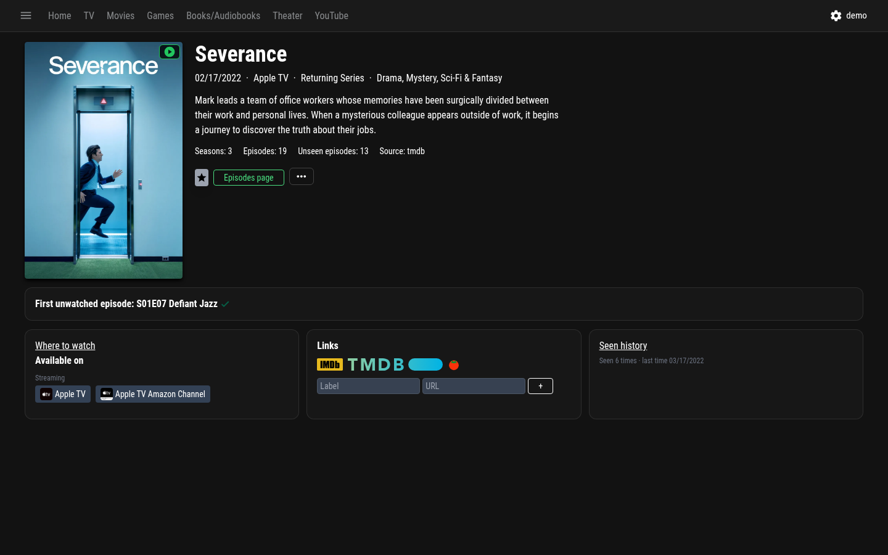
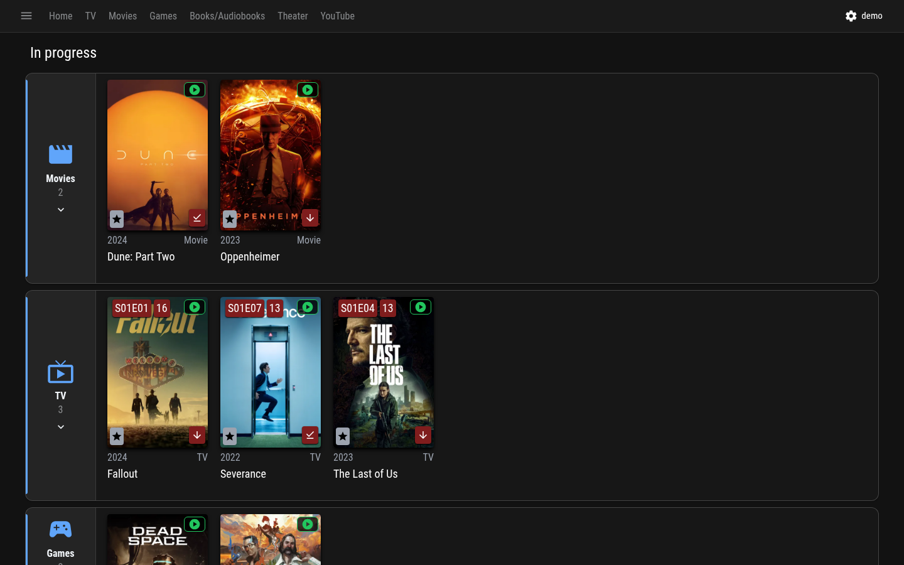

<p align="center"></p>

<h1 align="center">MediaOCD</h1>

<p align="center"><a href="README.md">English</a> | <b>Español</b></p>

<p align="center">
<a href="https://github.com/javimentallab/mediaocd/actions/workflows/build.yml"></a>
<a href="https://github.com/javimentallab/mediaocd/actions/workflows/trivy-scan.yml"></a>
<a href="https://github.com/javimentallab/mediaocd/releases/latest"></a>
<a href="./LICENSE"></a>
</p>

> *Un gestor multimedia para obsesivos del orden: de los que quieren saber cuál de las 14 producciones de «La casa de Bernarda Alba» vieron en realidad.*

Gestor autoalojado de todo lo que ves, lees, juegas, escuchas y a lo que asistes (películas, series, videojuegos, libros, audiolibros, teatro y vídeos de YouTube) con el nivel de detalle que los demás gestores no se molestan en tener.

<p align="center">
  
  
</p>

---

## Qué es

Un gestor pensado para **completistas**, con el castellano como primer idioma y traducido a 16 idiomas:

- **Verbos de consumo por medio**, no solo «visto»: jugado / visto / leído / escuchado / asistido. Un mismo elemento puede tener varios.
- **Página «En proceso» que se ordena sola**: todo lo que estás viendo, leyendo, jugando o escuchando, de cualquier tipo. Las series en emisión se quedan mientras vas al día, la tarjeta muestra el siguiente capítulo (incluso uno que hayas visto antes de su estreno) y la serie sale sola cuando termina su temporada o la serie entera. Lo abandonado tiene su propia lista. Puedes hacerla tu página de inicio.
- **Progreso en unidades reales**: horas y minutos para películas, juegos, teatro y capítulos; páginas para libros; posición para audiolibros, con un indicador de capítulo sobre las barras de lectura y escucha y el número real de capítulos de los audiolibros de Audible.
- **Integración con Jellyfin en los dos sentidos**: marca como descargado lo que aparece en tu biblioteca de Jellyfin, abre enlaces directos «Reproducir en Jellyfin» y sincroniza de vuelta lo que ves allí.
- **YouTube como tipo de contenido de primera**: suscríbete a canales, marca vídeos como vistos y consulta el feed reciente, con una caché persistente que aguanta las caídas del RSS de YouTube.
- **Teatro con metadatos serios**: SPARQL de Wikidata para las obras canónicas y scraping de teatro.es (CDT/INAEM, España) para los montajes contemporáneos.
- **Lista de seguimiento ordenada por fecha de alta**; las series terminadas salen solas.
- **Notas externas en la ficha**: nota de FilmAffinity en películas y series y Metascore de Metacritic en juegos, junto a los logos de IMDb/TMDB/IGDB y guardadas en caché en el servidor.
- **Detección de duplicados** y herramientas de fusión que no pierden vistos, puntuaciones ni listas.
- **Copia de seguridad y restauración completas**, con restauración automática si falta `data.db`, además de exportación a JSON y a CSV de Letterboxd.
- **Funciona con asistentes de IA (MCP)**: el servidor opcional de [`contrib/mcp-server`](contrib/mcp-server/README.es.md) permite a un asistente buscar en tu biblioteca, marcar cosas como vistas y gestionar la lista de seguimiento y las puntuaciones.
- **16 idiomas de interfaz**: inglés, castellano, portugués, francés, alemán, italiano, neerlandés, polaco, ruso, ucraniano, danés, chino, japonés, coreano, tailandés e hindi. Sigue el idioma del navegador; *Ajustes → Configuración → Idioma de la interfaz* fuerza uno.

Pensado para vivir en tu propia infraestructura junto a Jellyfin, qBittorrent, Home Assistant y lo que tengas.

## Instalación

Necesita Docker Engine 20 o superior con el plugin Compose v2.

```sh
git clone https://github.com/javimentallab/mediaocd.git
cd mediaocd

cp docker-compose.example.yml docker-compose.yml
${EDITOR:-nano} docker-compose.yml      # opcional: Jellyfin / YouTube (Google OAuth)

docker compose build mediaocd
docker compose up -d mediaocd
```

Abre `http://localhost:7481`: el primer usuario que se registra es el administrador.

**Los tokens y credenciales** se gestionan desde `Ajustes → Tokens de aplicación`:
- IGDB (obligatorio para videojuegos)
- Clave de API de TMDB (recomendada para «Dónde ver» y la duración de los capítulos: pégala en la interfaz; se guarda en `/storage/tmdb-key.json` con modo 0600)
- Jellyfin (URL + clave de API)
- YouTube (Google OAuth)

Para ponerlo detrás de tu propio dominio, consulta [`SETUP_DOMAIN.md`](SETUP_DOMAIN.md) (en inglés).

## Endpoints propios

| Método | Ruta | Para qué sirve |
|---|---|---|
| `GET` | `/api/backup` | Descarga el `data.db` binario (admin) |
| `GET` | `/api/backup/export-json` | Exportación completa en JSON (admin) |
| `GET` | `/api/backup/letterboxd` | CSV importable en letterboxd.com (admin) |
| `POST` | `/api/backup/restore` | Sube un `.db` para restaurarlo en el siguiente arranque (admin) |
| `POST` | `/api/backup/import` | Fusiona una exportación JSON (empareja por TMDB/IMDB/IGDB/TVDB) (admin) |
| `POST` | `/api/catalog/cleanup` | Purga los mediaItems huérfanos (admin) |
| `GET` `/POST` | `/api/dupes` | Detecta y fusiona duplicados (admin) |
| `PATCH` | `/api/downloaded` | Cambia la marca de «descargado» |
| `GET` `/PUT` | `/api/links` | Enlaces externos por elemento |
| `GET` | `/api/watch-providers` | Dónde ver (proveedores de TMDB) |
| `PUT` | `/api/audio-progress` | Progreso de escucha |
| `PUT` | `/api/episode-progress` | Progreso por capítulo |
| `POST` | `/api/episodes/fetch-runtimes` | Actualiza la duración de los capítulos (TMDB) |
| `GET` | `/api/hltb` | Datos de HowLongToBeat de un juego |
| `GET` | `/api/filmaffinity` | Nota de FilmAffinity de una película o serie (`?mediaItemId=`) |
| `GET` | `/api/metacritic` | Metascore de Metacritic de un juego (`?mediaItemId=`) |
| `GET` `/PUT` | `/api/tmdb/key` | Clave de API de TMDB gestionada desde la interfaz (admin) |
| `GET` `/POST` `/DELETE` | `/api/youtube/channels` | Suscripciones de YouTube |
| `GET` | `/api/youtube/feed` | Vídeos recientes (`?fresh=1` para saltarse la caché) |
| `*` | `/api/youtube/oauth/*` | Google OAuth (start/callback/status/sync) |
| `POST` `/DELETE` | `/api/youtube/watched` | Marca o desmarca un vídeo como visto |
| `GET` | `/api/youtube/watched-stats` | Totales de vídeos vistos del usuario |
| `GET` `/POST` | `/api/jellyfin/*` | Estado, sincronización y configuración (admin) |

## Complemento: `contrib/jf-torrents-organize`

Opcional, pero recomendable si usas **qBittorrent + Jellyfin** junto a MediaOCD.

qBittorrent guarda los torrents en rutas con el nombre de la release
(`/data/torrents/Title (YYYY) [Bluray 1080p][Esp]/foo.mkv`). Jellyfin empareja
mal los metadatos con esos nombres, así que la marca de **Descargado** de
MediaOCD, que se lee de Jellyfin, nunca se enciende. La solución no es renombrar
la carpeta de qBit (eso rompe la siembra), sino crear **hardlinks** en una
estructura paralela limpia que Jellyfin indexe bien. Mismo inodo, cero bytes más
en disco.

`contrib/jf-torrents-organize/` incluye un pequeño script en Python y unidades de
systemd que hacen justo eso, además de una llamada a `/Library/Refresh` de Jellyfin
para que lo nuevo aparezca al momento. Lee la URL y la clave de API de Jellyfin
directamente del almacenamiento de MediaOCD (`/storage/jellyfin-config.json`), así
que si ya configuraste Jellyfin en MediaOCD no necesitas más credenciales.

Los requisitos de estructura, las variables de entorno y las trampas están en
[`contrib/jf-torrents-organize/README.md`](contrib/jf-torrents-organize/README.md) (en inglés).

## Complemento: `contrib/mcp-server`

Servidor [MCP](https://modelcontextprotocol.io) opcional con el que un asistente de IA puede buscar en tu biblioteca, marcar cosas como vistas y gestionar la lista de seguimiento y las puntuaciones: consulta [`contrib/mcp-server/README.es.md`](contrib/mcp-server/README.es.md).

## Copias de seguridad desde el host

La imagen no incluye cron. El patrón recomendado:

```cron
0 3 * * * /ruta/a/backup-mediaocd.sh >> /ruta/a/backup.log 2>&1
30 3 * * * bash /ruta/a/verify-backup.sh --quiet >> /ruta/a/verify.log 2>&1
```

Los dos scripts usan `docker exec mediaocd` y rotan guardando 7 diarias, 4 semanales y 3 mensuales. Lo mejor es tenerlos fuera de la imagen, junto al volumen de datos.

## Desarrollo

No hay paso de compilación: la imagen copia `app/` tal cual sobre la imagen oficial de Node
e instala las dependencias desde `app/package-lock.json`.

```
.
├── app/
│   ├── build/              # servidor (Node, Express, SQLite con knex): se editan directamente los .js
│   ├── public/             # cliente web: index.html, el bundle main_*.js, CSS, service worker, iconos
│   ├── package.json        # dependencias; app/package-lock.json fija el árbol exacto
│   └── package-lock.json
├── docker/entrypoint.sh    # PUID/PGID, restauración automática de data.db desde el último backup, arranque
├── tools/rehash-web.js     # ejecutar tras editar app/public (renombra el bundle y actualiza el service worker)
├── docs/                   # logo y capturas
├── contrib/                # jf-torrents-organize, mcp-server
├── Dockerfile
├── docker-compose.example.yml
├── release.sh
├── NOTICE                  # componentes de terceros y sus licencias
├── CHANGELOG.md
└── .github/workflows/
    ├── build.yml           # construye la imagen, la arranca y comprueba que responde
    └── trivy-scan.yml      # vulnerabilidades, secretos y fallos de configuración en la imagen y el repo, en push/PR/semanal + SARIF a la pestaña Security
```

- **Cambios en el servidor**: edita `app/build/**` y reconstruye la imagen (`docker compose up -d --build mediaocd`).
- **Cambios en el cliente web**: edita `app/public/main_*.js`, `.css` o `index.html` y ejecuta
  `node tools/rehash-web.js` antes de construir, para que los navegadores y el service worker cojan los ficheros nuevos.
- **Las traducciones** están en el bundle, un catálogo por idioma (busca `"In progress":`).
- **Dependencias**: edita `app/package.json`, construye y actualiza el lock con
  `docker cp mediaocd:/app/package-lock.json app/`.
- **Node**: cambia la etiqueta y el digest en la línea `FROM` del `Dockerfile`.

## Publicar una versión

```sh
./release.sh 2.0.0
```

- Antes, escribe la entrada en [`CHANGELOG.md`](CHANGELOG.md) y haz su commit.
- Se detiene si hay cambios sin commitear, si la rama no es `main`, si la etiqueta ya existe o si la versión no sigue semver.
- Sube la versión en `app/build/config.js`, `app/package.json` y `app/package-lock.json`.
- Hace el commit, crea la etiqueta `v2.0.0`, sube las dos cosas y prepara un borrador de release en GitHub con los commits desde la etiqueta anterior, para que lo edites antes de publicarlo.

## Contribuir

Consulta [CONTRIBUTING](CONTRIBUTING.md), en inglés. Para avisar en privado de un problema de seguridad, consulta [SECURITY](SECURITY.md).

## Licencia

MIT: consulta [`LICENSE`](LICENSE). Los componentes de terceros y sus licencias están en [`NOTICE`](NOTICE).
